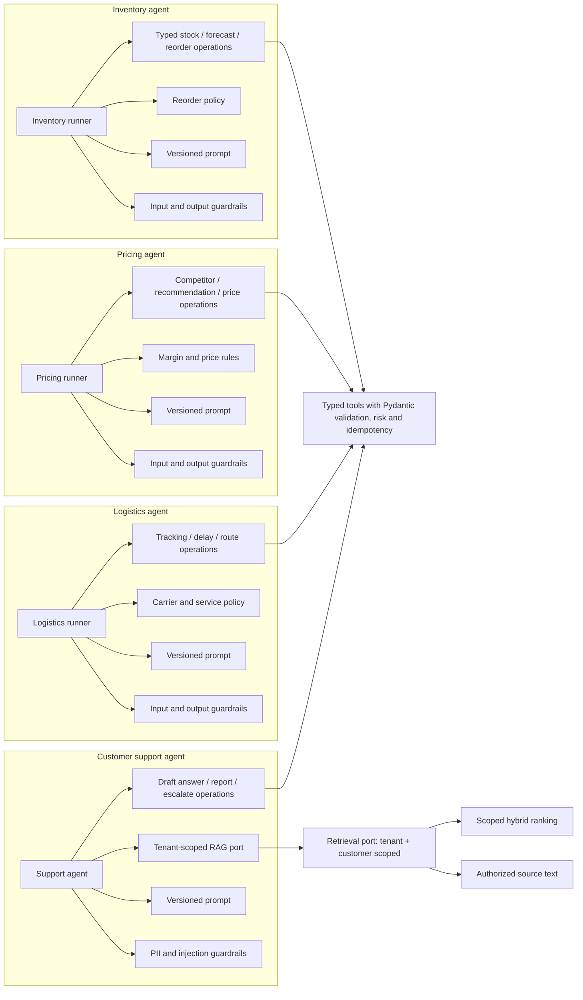
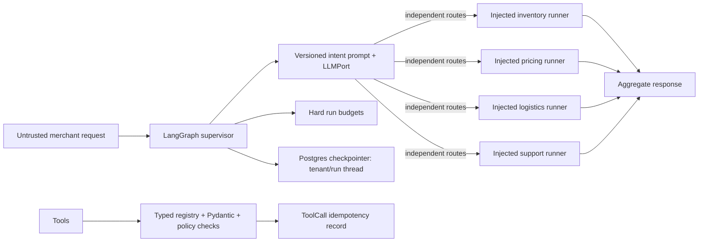

# Agent component diagrams

Phase 3 implements deterministic agent services behind replaceable ports and fake integrations.
Inventory, pricing, and logistics proposals do not execute external writes. Support retrieval requires
both tenant and customer scope and produces drafts only. Merchant thresholds and provider selections
remain explicit inputs until supplied.

## Phase 2 runtime

The dispatcher invokes configured tenant-scoped runners and aggregates their summaries. If a runner
is not configured, it reports that fact rather than claiming the agent completed work. Phase 4 adds
graph interrupts and approval resume before high-risk writes.

