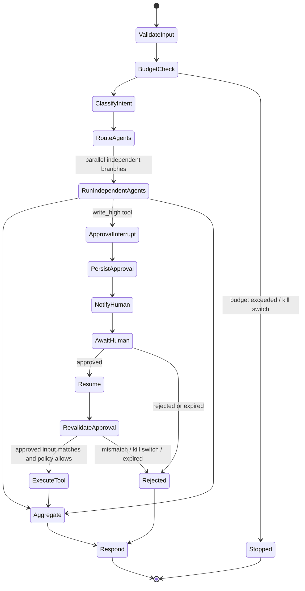

# Supervisor LangGraph state diagram

The graph checkpoints each node through LangGraph's PostgreSQL saver.
Checkpoint `thread_id` is derived from the authenticated tenant UUID and run UUID; it is never
accepted from a client. Agent branches are dispatched with LangGraph `Send` and merged before
aggregation. A high-risk tool persists a tenant-scoped approval and audit event before LangGraph
`interrupt`; after resume, the verifier checks the exact approved tool input, tenant, run, tool name,
expiry and current kill-switch context before execution. Approval expiry resumes with rejection.

