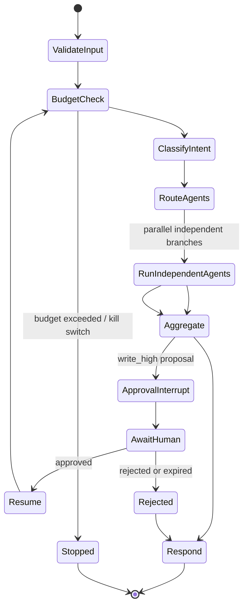

# Supervisor LangGraph state diagram

The implemented Phase 2 graph checkpoints each node through LangGraph's PostgreSQL saver.
Checkpoint `thread_id` is derived from the authenticated tenant UUID and run UUID; it is never
accepted from a client. Agent branches are dispatched with LangGraph `Send` and merged before
aggregation. The initial branch nodes only confirm routing; business tools arrive in Phase 3.

