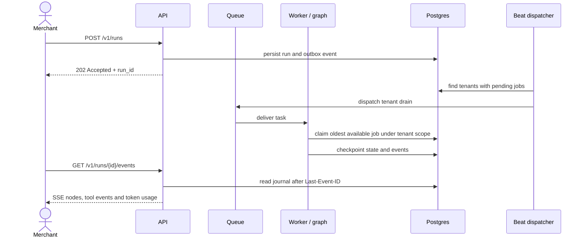
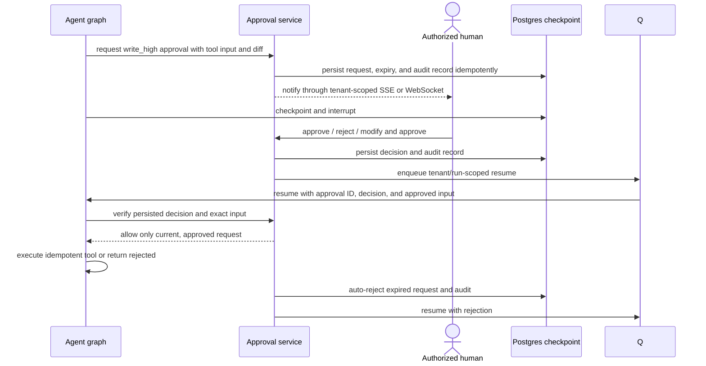
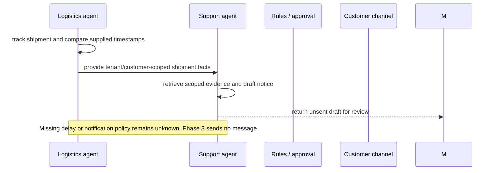
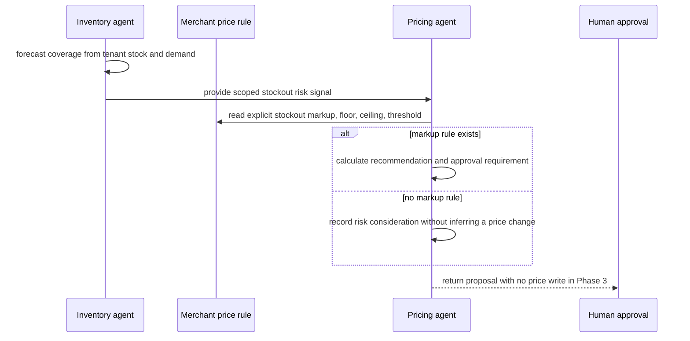
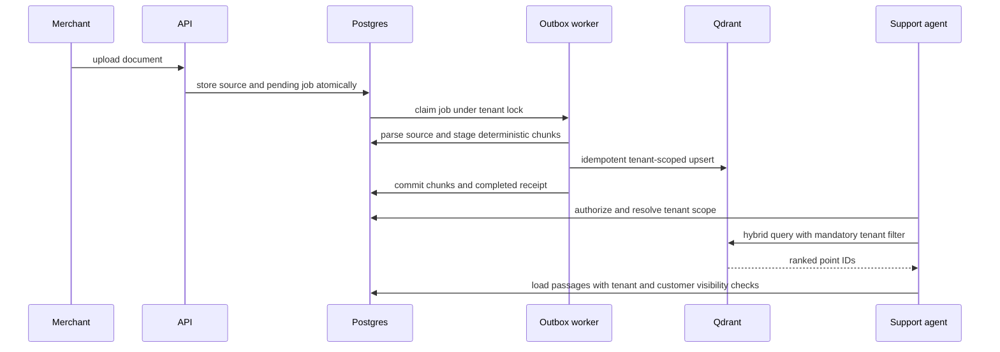
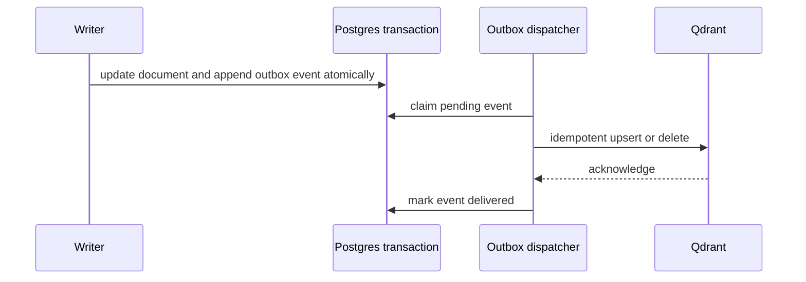
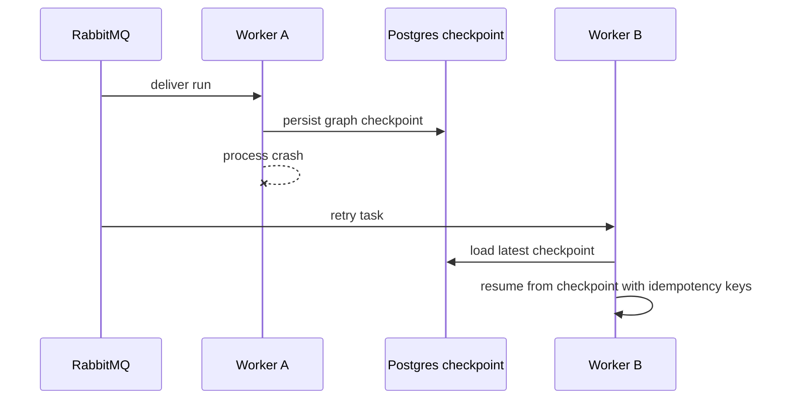
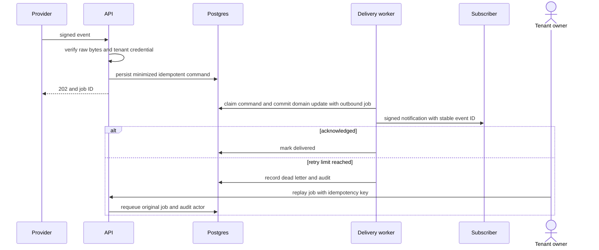

# Key sequences

## Run lifecycle

## HITL approval and resume

## Shipment delay cross-agent flow

## Stockout risk to pricing consideration

## RAG ingestion and retrieval

## Outbox synchronization

## Crash recovery

Phase 2 validates recovery by interrupting after the classification checkpoint, terminating the
worker subprocess, starting a replacement process, and resuming the same tenant/run thread from
PostgreSQL. Recovery latency is not measured yet.

## Signed notifications and replay

