# Tenant data model

`tenants` is the root registry. Every other table carries `tenant_id`, has PostgreSQL RLS enabled and forced, and uses the transaction-local `app.current_tenant_id` setting. Memory jobs form the durable outbox.

```mermaid
erDiagram
  TENANT ||--o{ USER : owns
  TENANT ||--o{ API_KEY : owns
  TENANT ||--o{ REFRESH_TOKEN : owns
  TENANT ||--o{ PRODUCT : owns
  TENANT ||--o{ WAREHOUSE : owns
  TENANT ||--o{ SUPPLIER : owns
  TENANT ||--o{ INVENTORY_ITEM : owns
  TENANT ||--o{ CUSTOMER : owns
  TENANT ||--o{ ORDER : owns
  TENANT ||--o{ CARRIER : owns
  TENANT ||--o{ SHIPMENT : owns
  TENANT ||--o{ SHIPMENT_EVENT : owns
  TENANT ||--o{ PRICE_RULE : owns
  TENANT ||--o{ PRICE_SNAPSHOT : owns
  TENANT ||--o{ COMPETITOR_LISTING : owns
  TENANT ||--o{ CONVERSATION : owns
  TENANT ||--o{ MESSAGE : owns
  TENANT ||--o{ AGENT_RUN : owns
  TENANT ||--o{ AUTONOMY_SETTING : owns
  TENANT ||--o{ APPROVAL_REQUEST : owns
  TENANT ||--o{ TOOL_CALL : owns
  TENANT ||--o{ AUDIT_LOG : owns
  TENANT ||--o{ TOKEN_USAGE : owns
  USER ||--o{ API_KEY : creates
  USER ||--o{ REFRESH_TOKEN : owns
  PRODUCT ||--o{ INVENTORY_ITEM : stocked_as
  WAREHOUSE ||--o{ INVENTORY_ITEM : stores
  CUSTOMER ||--o{ ORDER : places
  CUSTOMER ||--o{ CONVERSATION : starts
  ORDER ||--o{ SHIPMENT : fulfilled_by
  CARRIER ||--o{ SHIPMENT : carries
  SHIPMENT ||--o{ SHIPMENT_EVENT : records
  PRODUCT ||--o{ PRICE_RULE : governed_by
  PRODUCT ||--o{ PRICE_SNAPSHOT : priced_at
  PRODUCT ||--o{ COMPETITOR_LISTING : compared_to
  CONVERSATION ||--o{ MESSAGE : contains
  AGENT_RUN ||--o{ APPROVAL_REQUEST : pauses_for
  AGENT_RUN ||--o{ TOOL_CALL : invokes
  AGENT_RUN ||--o{ TOKEN_USAGE : records
  USER ||--o{ AUDIT_LOG : performs
  CUSTOMER ||--o{ MEMORY_DOCUMENT : owns_private
  TENANT ||--o{ MEMORY_DOCUMENT : owns
  MEMORY_DOCUMENT ||--o{ MEMORY_CHUNK : contains
  TENANT ||--o{ MEMORY_JOB : schedules
  TENANT {
    uuid id PK
    string slug UK
    string name
  }
  USER {
    uuid id PK
    uuid tenant_id FK
    string email
    string role
    string password_hash
  }
  API_KEY {
    uuid id PK
    uuid tenant_id FK
    uuid user_id FK
    string key_hash
    string permissions
  }
  REFRESH_TOKEN {
    uuid id PK
    uuid tenant_id FK
    uuid user_id FK
    string token_hash
    datetime expires_at
  }
  PRODUCT {
    uuid id PK
    uuid tenant_id FK
    string sku
    string name
  }
  WAREHOUSE {
    uuid id PK
    uuid tenant_id FK
    string name
    string region
  }
  SUPPLIER {
    uuid id PK
    uuid tenant_id FK
    string name
    string contact_email
  }
  INVENTORY_ITEM {
    uuid id PK
    uuid tenant_id FK
    uuid product_id FK
    uuid warehouse_id FK
    int quantity
  }
  CUSTOMER {
    uuid id PK
    uuid tenant_id FK
    string display_name
    string email
    string phone
  }
  ORDER {
    uuid id PK
    uuid tenant_id FK
    uuid customer_id FK
    string status
    decimal total
  }
  CARRIER {
    uuid id PK
    uuid tenant_id FK
    string name
  }
  SHIPMENT {
    uuid id PK
    uuid tenant_id FK
    uuid order_id FK
    uuid carrier_id FK
    string tracking_number
  }
  SHIPMENT_EVENT {
    uuid id PK
    uuid tenant_id FK
    uuid shipment_id FK
    string event_type
    json payload
  }
  PRICE_RULE {
    uuid id PK
    uuid tenant_id FK
    uuid product_id FK
    decimal min_price
    decimal max_price
  }
  PRICE_SNAPSHOT {
    uuid id PK
    uuid tenant_id FK
    uuid product_id FK
    decimal price
  }
  COMPETITOR_LISTING {
    uuid id PK
    uuid tenant_id FK
    uuid product_id FK
    string source
    decimal price
  }
  CONVERSATION {
    uuid id PK
    uuid tenant_id FK
    uuid customer_id FK
    string status
  }
  MESSAGE {
    uuid id PK
    uuid tenant_id FK
    uuid conversation_id FK
    string direction
    text body
  }
  AGENT_RUN {
    uuid id PK
    uuid tenant_id FK
    string agent_name
    string status
    string autonomy_mode
  }
  AUTONOMY_SETTING {
    uuid id PK
    uuid tenant_id FK
    string agent_name
    string mode
    uuid updated_by FK
  }
  APPROVAL_REQUEST {
    uuid id PK
    uuid tenant_id FK
    uuid agent_run_id FK
    string action
    string tool_idempotency_key
    string risk_level
    string status
    json context
    datetime expires_at
    datetime decided_at
  }
  TOOL_CALL {
    uuid id PK
    uuid tenant_id FK
    uuid agent_run_id FK
    string tool_name
    string risk_level
  }
  AUDIT_LOG {
    uuid id PK
    uuid tenant_id FK
    uuid actor_id FK
    string action
    string entity_type
  }
  TOKEN_USAGE {
    uuid id PK
    uuid tenant_id FK
    uuid agent_run_id FK
    string model
    int input_tokens
    int output_tokens
  }
```

