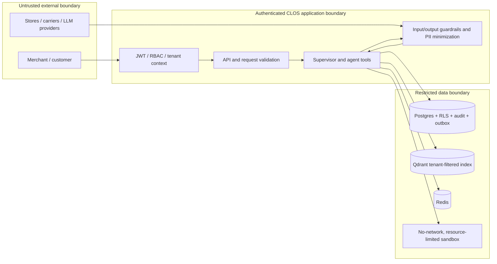

# Trust boundaries and STRIDE threat model

| STRIDE risk | Phase 0 treatment / required follow-up |
|---|---|
| Spoofing | JWT and RBAC are planned; no authentication exists in Phase 0. |
| Tampering | Input validation and audit records are required in later phases. |
| Repudiation | Append-only audit records are part of the data model plan. |
| Information disclosure | Tenant RLS, PII minimization, and retrieval filters are required before data features. |
| Denial of service | Per-tenant budgets, rate limits, timeouts, and queue controls are later-phase work. |
| Elevation of privilege | Risk-typed tools and approval interrupts are required before writes. |

Treat retrieved documents and all external tool output as untrusted data, never as instructions.

